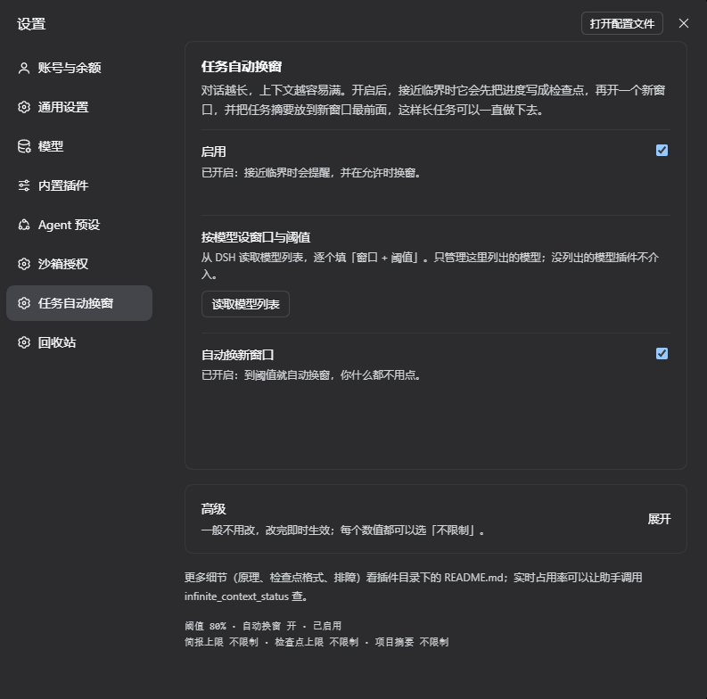

# Task Auto-Handoff · 任务自动换窗

**dsh-infinite-context-orchestrator** — keep a long task going across context limits: write a checkpoint, open a new session, inject the brief.

**中文**：[README.zh.md](README.zh.md) · **English**：[README.en.md](README.en.md) · **小白指南 / Plain guide**：[USERGUIDE.md](USERGUIDE.md)

| | |
|---|---|
| **它解决什么** | 长任务聊久了上下文会满，通常要手工总结、重开会话、再讲一遍进度。开启后，接近阈值时插件自动写交接检查点、开新会话，并把「原始需求 / 目标 / 已完成 / 待办 / 约束」放到新会话最前面。 |
| **What it solves** | Long tasks eventually fill the context. Near the threshold the plugin writes a handoff checkpoint, opens a new session and puts the *original requirement / goal / done / pending / constraints* at the top of it. |
| **安装 / Install** | `dsh plugin --profile <profile> add dsh-infinite-context-orchestrator`（或本地目录 / or a local checkout），然后重启 DSH。 |
| **配置 / Configure** | 设置 → 任务自动换窗：启用、按模型设「窗口 + 阈值」、自动换新窗口。 / Settings → Task Auto-Handoff: enable, per-model window + threshold, auto-handoff. |
| **许可证 / License** | MIT（[LICENSE](LICENSE)） · 需要 DSH ≥ 0.2.1-rc.2、Node ≥ 20 |
