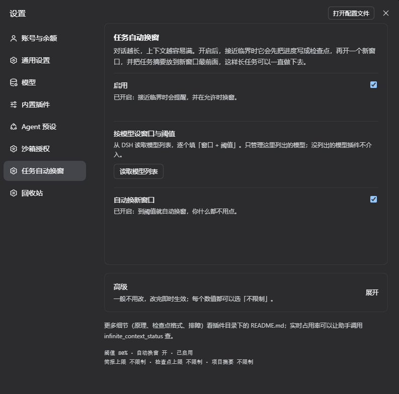

# 任务自动换窗（dsh-infinite-context-orchestrator）



**简体中文** · [English](README.en.md)

> 📖 **第一次用、或者不太想看术语？先读 [USERGUIDE.md](USERGUIDE.md)**（大白话版：它是干什么的、怎么装、怎么设置、常见问题）。

**它解决什么问题**：长任务聊久了，上下文会满，你就得手动总结、重开会话、再把进度讲一遍。

**它怎么做**：快满的时候，它先把当前进度写成一份**交接检查点**，再开一个**新会话**，并把「**原始需求原文** / 当前目标 / 已完成 / 待办 / 必须遵守的约束」放到新会话最前面。于是新窗口从第一句话就知道该接着干什么，你不用再复述。

---

## 安装形态（复制安装 vs 链接安装）

dsh plugin add <目录> 建的是**Junction（链接）**：DSH 加载的其实是工作区里的文件，整理工作区会影响已安装的插件。

本插件提供复制安装脚本，插件目录里放独立副本，工作区只作镜像源：

```powershell
powershell -ExecutionPolicy Bypass -File scripts\install-copy.ps1              # 默认 profile=desktop
powershell -ExecutionPolicy Bypass -File scripts\install-copy.ps1 -WhatIf      # 只看会做什么
```

之后改代码的流程：pnpm run build → 再跑一次脚本 → 重启 DSH。

## 维护工具

- `node scripts/repair-sessions.mjs`：扫描会话日志，找出「在 turn 之外写了 `developer/message`」的坏记录
  （会表现为 GUI「历史加载失败」）。默认只报告，加 `--apply` 才改写，改写前自动备份 `*.corrupt-bak`。

## 语言

设置页主区（分区名、三个开关、模型列表、高级开关）跟随 DSH 的界面语言，
内置 **中文 / English**；其余语言（ja / es / fr / de / ru / pt）回落到英文。
长说明文字与插件发给模型的提示目前仍是中文。

## 怎么用

打开 **设置 → 任务自动换窗**，只有三个开关：

| 选项 | 说明 |
|---|---|
| **启用** | 总开关。关掉后插件完全不动作。 |
| **按模型设窗口与阈值** | 点「读取模型列表」后，每个模型一行：左边填**真实提示预算**（= n_ctx − max_tokens），右边填**该模型的阈值**。两项都留空 = 该模型不设置（插件不介入）。只能管理这里列出的模型。 |
| **自动换新窗口** | **默认关闭**。关闭时只提醒你，你确认后才换；开启后到阈值就自动换。 |

**「换窗后提醒旧窗口」**（默认开）：换完窗口会在**旧窗口的对话末尾**追加一条「任务已转移」消息
（写进会话日志、**不唤醒**旧窗口——避免它为了回一句话又开一轮、和新窗口抢模型）。
里面写明新会话 id、检查点路径与「本窗口只用于回顾」。关掉则完全不打扰旧窗口。

**「自动换窗次数上限」**（默认 10，0 = 不限制）：单次启动内最多自动换几次窗。
本地小窗口模型每个窗口只能干 2-3 万 tokens，一次长任务要换好几次；调太小会在第二个窗口就停住自动交接。

**「交接后收尾旧待办」**（默认开）：交接成功后，把旧窗口里未完成的待办标成「已完成」。
不这么做的话，旧窗口交接完就停手，那条「进行中」会一直挂着，看起来像交接失败。

**「简报由谁写」** 是高级里的一个选项：

- **插件模板**（默认）：从结构化事实（目标/待办/已完成/用户约束）生成，确定性、零额外模型调用。
- **模型撰写**：换窗前多跑一次模型调用，由模型写一份叙述性交接（做了什么、为什么这么做、下一步）；
  失败会自动回退模板，**不会阻断换窗**。模型只写叙述部分，「待办 / 检查点路径 / 收尾指令」
  仍由插件拼，保证新窗口拿得到可执行的下一步。

其余「高级」项一般不用动（简报字数上限、检查点大小上限、项目摘要预留、检查点存放目录），
每个都能「恢复默认」，改完即时生效。三个数值项都带 **「不限制」**：勾上就不做裁剪
（简报条数与字数、检查点体积、项目摘要长度都不再受限）。**用模型撰写时建议直接把简报上限
设成「不限制」**——几千字简报对 128K 窗口只是零头，没必要省。

## 到临界时会看到什么

一条**插件提示**（不是你的发言，也不打断当前工作）：

```
【任务自动换窗】上下文占用 82.3%（…），已达阈值 80%。
将写入检查点并换窗；autoHandoff=false，等你确认后调用 infinite_context_handoff 执行。
```

- **自动换窗关着**：你说一句「换窗」或「调用 infinite_context_handoff」，它才会执行完整流程。
- **自动换窗开着**：直接换，换完当前会话也会收到一条「已完成、新会话是 xxx」的说明。
- 想随时看状态（占用率、阈值、最近检查点），让助手调用 `infinite_context_status`。

## 新窗口是怎么被"启动"和"督促"的

- 换窗是**插件**做的（写检查点 → 建新会话 → 注入简报 → 发首条消息），不是模型自己切换会话。
- 新窗口的**第一步**由插件用 `followup` 发一条消息来触发（这条消息会唤醒 agent、开启第一轮）。
- 「第一件事做什么」额外以 **developer 消息**写进新会话历史开头（优先级高于普通用户消息）；
  若宿主不接受该形状，会自动退化成把锚点拼在简报最前面。
- **督工**：新窗口的首条回复如果只说话不动手（没有工具调用，且回复很短或以问句结尾），
  插件会补发一次纠正，点名待办第一项——只补一次，不会刷屏。

## 常见问题

**为什么显示 1,000,000 tokens？**
模型配置里没声明 `contextWindow` 时，宿主用适配器默认值。想让它贴近真实可用窗口，
给模型补 `contextWindow` 即可（否则百分比会偏小，阈值不容易触发）。

**设置里没有「任务自动换窗」这一页 / 页面是空的？**
先硬刷新页面（`Ctrl+Shift+R`）。还是不行，按 `F12` 看控制台里 `[dsh-infinite-context]` 开头的日志。

**换了配置怎么生效？**
在设置页保存即可（它会自己 reconcile）。手改 profile 的 `cordis.patch.yml` 后，需要重启 DSH
或重跑一次 `dsh plugin add <本目录>`。

**升级/改了插件代码之后？**
只改界面（`client.js`）→ 硬刷新页面（`Ctrl+Shift+R`）。改了宿主部分（`lib/index.js`，比如
新增了设置页要用的接口）→ **必须重启 DSH**，运行中的进程不会热加载插件模块。

**换了窗，检查点在哪？**
默认 `~/.dsh/task-checkpoints/orchestrator/`：`handoffs/<会话id>.json` 是最新一份（上一版留在
`<同名>.previous`），`handoffs/history/` 是不可变历史，`latest.json` 是指针。

**会不会把密钥写进检查点？**
不会。写入前会脱敏（`sk-*`、GitHub/AWS token、JWT、`Bearer`、`password=`、PEM 私钥、本机用户名路径）。

**换窗会不会丢东西？**
检查点写失败会**直接放弃换窗**（fail-closed），留在原会话；新会话创建失败则保留检查点并给出路径。

## 致谢

这个插件的**判据、契约、边界**几乎都来自四个 DSH 插件，作者与仓库如下（均为 MIT，版权归各自作者）：

| 插件 | 作者 | 仓库 | 借用的是 |
|---|---|---|---|
| `dsh-context-relay` | rezon-aki | [rezon-aki/dsh-context-relay](https://github.com/rezon-aki/dsh-context-relay) | `contextPressure` 投影与判档口径、notice 消息形状、换窗的 Session API 路径 |
| `dsh-task-checkpoint-guard` | jlnkx5200-beep | [jlnkx5200-beep/dsh-task-checkpoint-guard](https://github.com/jlnkx5200-beep/dsh-task-checkpoint-guard) | 检查点原子写与 `.previous` 保留的持久化契约、脱敏思路 |
| `dsh-project-progress` | Jolly-J | [Jolly-J/dsh-project-progress](https://github.com/Jolly-J/dsh-project-progress) | `PROGRESS.md` 的区域结构（项目级摘要来源） |
| `dsh-context-window` | qq-24 | [qq-24/dsh-context-window](https://github.com/qq-24/dsh-context-window) | 「换窗必须新会话」的边界、schemastery Config 与 fail-loud 的写法 |
| `dsh-context-window`（设计笔记） | CooperZhuang | [CooperZhuang/dsh-context-window](https://github.com/CooperZhuang/dsh-context-window) | 其 `docs/handoff.md` 整理的 DSH API 地图 |

具体到"哪一行代码借鉴了哪个契约"、以及本插件与它们的边界，写在 **[CREDITS.md](CREDITS.md)**。
本项目源码为独立实现，运行时**零依赖**（不 import 上述任何模块）。

## 配套建议：约束单次 `read` 的读入量

小窗口模型（如本地 64K）里，**一次 `read` 大文件就能顶掉半个窗口**，而且**读进来的内容会常驻上下文**
（之后每一轮请求都会重新发送，不会"读完就清理"）。实测：一步连读三个文件（合计约 82 KB）
让上下文从 1.4 万跳到约 5 万 tokens，紧接着的请求被服务端 `400 prompt + max_tokens exceeds n_ctx` 打断。

两种防法：

1. **DSH 侧限流**（全局生效）：profile 的 `cordis.patch.yml` 里给内置 `tool-fs` 加上限——
   `readLimit`（行）、`readMaxBytes`（字节）、`readMaxLineLength`（单行字符），默认分别是 2000 / 50 KB / 2000。
2. **指令侧约束**（本机目前用这个）：全局 `~/.dsh/AGENTS.md` 要求「一次只读 1 个文件、≤ 400 行 / ≤ 12 KB，
   超出用 `offset`/`limit` 续读；禁止一个 step 连读多个大文件」。

另外本插件也做了兜底：`step/end`、`tool/result` 之后会让占用缓存失效，所以**一步之内暴涨也能在下一个
pre-step 被看到**，只要阈值低于服务端报错线，就会在发请求前换窗。
## 给要改它的人

原理、闭环实现细节、设置页的三条硬约束、离线测试与本机实测记录，全部在
**[docs/ARCHITECTURE.md](docs/ARCHITECTURE.md)**；发布前检查清单见 **[PUBLISHING.md](PUBLISHING.md)**；
版本变更见 **[CHANGELOG.md](CHANGELOG.md)**；许可见 **[LICENSE](LICENSE)**（MIT）。

```powershell
pnpm install --ignore-scripts
pnpm run build          # esbuild → lib/index.js；tsc → lib/types
pnpm run smoke          # Host 60 项离线断言
pnpm run smoke:client   # Client 9 项离线断言
pnpm run check          # 上面全部 + 类型检查（发布门禁）
```
